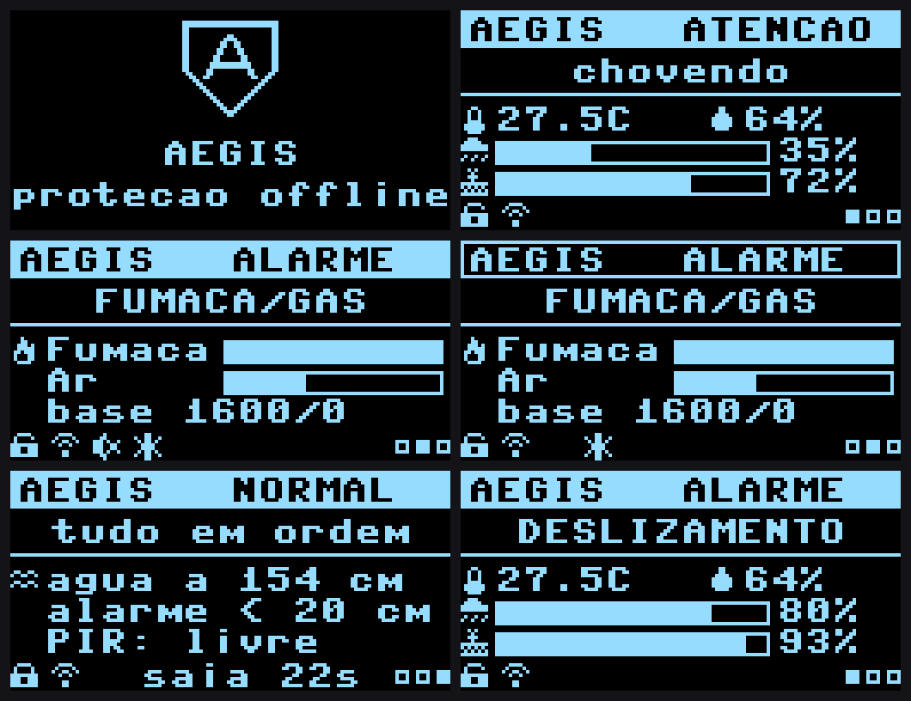

# Hardware do abrigo AEGIS

Guia para montar o circuito real com as mesmas ligações do Wokwi (`firmware/diagram.json`) e gravar
o firmware (`firmware/abrigo.aeg` → `firmware/main.py`). Se a montagem seguir este mapa, o
`main.py` que roda no simulador roda na placa sem nenhuma alteração.

## 1. Lista de compras

Preços consultados em 24/10/2026 em lojas brasileiras, preço normal (sem o desconto do Pix). Os itens
da base são os do orçamento do pitch (`pitch/aegis/data.py`). Preço de loja muda: confira antes de
comprar.

**Base (já no orçamento do pitch)**

| Qtd | Componente | Observação | Preço |
|---|---|---|---|
| 1 | ESP32 DevKit V1 (30 pinos, ESP-WROOM-32) | com cabo micro-USB **de dados** (cabo só de carga não grava) | R$ 59,90 |
| 1 | Sensor de presença PIR HC-SR501 | | R$ 11,90 |
| 1 | Sensor ultrassônico HC-SR04 | nível da água | R$ 9,90 |
| 1 | Sensor de gás/fumaça MQ-2 (módulo com saída AO) | | R$ 14,72 |
| 1 | Sensor de qualidade do ar MQ-135 (módulo com saída AO) | | R$ 16,90 |
| 1 | DHT22 (módulo de 3 pinos) | o módulo já tem o pull-up de 10 kΩ | R$ 45,00 |
| 1 | Buzzer **passivo** + LEDs 5 mm verde, amarelo e vermelho | o buzzer ativo só faz um tom e ignora a frequência | R$ 21,40 |
| 1 | Fonte 5 V 2 A | | R$ 17,00 |
| 1 | Protoboard 830 pontos | | R$ 11,90 |
| 1 | Kit de jumpers macho-macho e macho-fêmea | | R$ 8,90 |
| 1 | Case | | R$ 18,40 |
| | | **Subtotal da base** | **R$ 235,92** |

**Novos (fora do orçamento do pitch)**

| Qtd | Componente | Para quê | Preço | Loja |
|---|---|---|---|---|
| 1 | Display OLED 0,96" SSD1306 **I2C** (4 pinos) | tela; o de 7 pinos é SPI e não serve | R$ 26,90 | Eletrogate |
| 1 | Leitor biométrico AS608 (com cabo) | arma e desarma o sistema com a digital | R$ 119,90 | MakerHero |
| 1 | Sensor de chuva FC-37 / YL-83 (placa + módulo) | detecta o início da chuva | R$ 7,90 | Eletrogate |
| 1 | Sensor capacitivo de umidade do solo v1.2 | solo encharcado: risco de deslizamento | R$ 10,90 | Smartkits |
| 1 | Módulo relé 5 V, 1 canal | liga exaustor ou sirene externa | R$ 6,90 | Eletrogate |
| 1 | Push button 6×6 mm | silenciar o alarme | a cotar | |
| 3 | Resistores 220 Ω | um para cada LED | a cotar | |
| 1 + 1 | Resistores 1 kΩ e 2 kΩ (ou 2× 1 kΩ em série) | divisor do ECHO do HC-SR04 | a cotar | |
| 2 + 2 | Resistores 10 kΩ e 20 kΩ (ou 2× 10 kΩ em série) | divisores das saídas dos MQ | a cotar | |
| | | **Subtotal dos novos** | **R$ 172,50** + botão e resistores | |

**Total: R$ 408,42**, mais o botão e os resistores. Essas peças custam centavos cada, mas não achei
preço confiável numa loja brasileira para somar.

O leitor biométrico sozinho custa metade da base. Sem ele, o total cai para R$ 288,52.

Fontes dos itens novos:
[Eletrogate OLED](https://www.eletrogate.com/display-oled-128x64-0.96-i2c-branco),
[MakerHero AS608](https://www.makerhero.com/produto/modulo-leitor-de-impressao-digital/),
[Eletrogate chuva](https://www.eletrogate.com/modulo-sensor-de-chuva),
[Smartkits solo](https://www.smartkits.com.br/sensor-capacitivo-de-umidade-do-solo),
[Eletrogate relé](https://www.eletrogate.com/modulo-rele-1-canal-5v).

## 2. Mapa de pinos

Os sensores analógicos ficam só no ADC1 (GPIO32–39), porque o ADC2 para de funcionar quando o WiFi
está ligado. Os números de pino abaixo são as `law PINO_*` do `abrigo.aeg`. Se mudar uma ligação, mude
também a `law` correspondente.

| Componente | Pino do componente | ESP32 | Alimentação |
|---|---|---|---|
| PIR HC-SR501 | OUT | GPIO27 (D27) | VCC → VIN (5 V); a saída já é 3,3 V |
| HC-SR04 | TRIG | GPIO25 (D25) | VCC → VIN (5 V) |
| HC-SR04 | ECHO | GPIO26 (D26) **pelo divisor 1k/2k** | |
| DHT22 | DATA (SDA) | GPIO4 (D4) | VCC → 3V3 |
| MQ-2 | AO | GPIO34 (D34) **pelo divisor 10k/20k** | VCC → VIN (5 V) |
| MQ-135 | AO | GPIO35 (D35) **pelo divisor 10k/20k** | VCC → VIN (5 V) |
| OLED SSD1306 | SDA / SCL | GPIO21 / GPIO22 | VCC → 3V3 |
| Botão | um lado / outro lado | GPIO14 / GND | usa o pull-up interno |
| Buzzer passivo | + / − | GPIO18 / GND | |
| LED verde | anodo (perna longa) | GPIO13 → 220 Ω → LED → GND | |
| LED amarelo | anodo | GPIO33 → 220 Ω → LED → GND | |
| LED vermelho | anodo | GPIO32 → 220 Ω → LED → GND | |
| Sensor de chuva (módulo) | AO | GPIO36 (VP) | VCC → 3V3; a placa de chuva vai nos dois pinos do módulo |
| Umidade do solo | AOUT | GPIO39 (VN) | VCC → 3V3 |
| Biometria AS608 | TX / RX | GPIO16 (RX2) / GPIO17 (TX2) | VCC → 3V3; confira no anúncio, porque alguns módulos pedem 3,8 a 7 V |
| Relé | IN | GPIO23 (D23) | VCC → VIN (5 V) |

Não ligue nada nos pinos D34 a D39 como saída: esses pinos são só de entrada. A saída DO dos módulos
MQ e do sensor de chuva (o limiar ajustado no trimpot azul) não é usada.

Os sensores de chuva e de solo são alimentados em 3,3 V, então o sinal nunca passa de 3,3 V e eles
não precisam de divisor.

**Relé:** se o módulo ligar com o pino em nível baixo (é o caso da maioria dos módulos com
optoacoplador), mude para `law RELE_ATIVO_EM_ALTO = dead`. Para conferir, ligue a placa sem fumaça:
o relé não pode estalar nem acender o LED dele. Para a demonstração, ligue no contato do relé uma carga de baixa tensão, como uma ventoinha
de 12 V ou uma sirene de 12 V com fonte própria. Ligar 127/220 V exige isolamento e conhecimento de
instalação elétrica. Os contatos do relé aguentam a rede, mas a protoboard não.

## 3. Alimentação e divisores de tensão

**Os pinos do ESP32 aceitam no máximo 3,3 V.** Três sensores são alimentados em 5 V e devolvem 5 V no
sinal: o ECHO do HC-SR04 e as saídas AO dos dois MQ. Esses sinais passam por um divisor resistivo
antes de chegar ao ESP32:

```
sinal 5 V ──[ R1 ]──┬── pino do ESP32        Vsaída = 5 V × R2 / (R1 + R2)
                    │
                  [ R2 ]
                    │
                   GND
```

| Sinal | R1 (em cima) | R2 (para o GND) | Tensão máxima no pino |
|---|---|---|---|
| ECHO do HC-SR04 → GPIO26 | 1 kΩ | 2 kΩ | 5 × 2/3 ≈ 3,33 V |
| AO do MQ-2 → GPIO34 | 10 kΩ | 20 kΩ | ≈ 3,33 V |
| AO do MQ-135 → GPIO35 | 10 kΩ | 20 kΩ | ≈ 3,33 V |

O PIR HC-SR501 não precisa de divisor, porque a saída dele já é 3,3 V. O TRIG do HC-SR04 também não
precisa: o ESP32 manda 3,3 V e o sensor aceita.

**Alimentação:**
- Cada MQ tem um aquecedor interno que consome cerca de 150 mA. Os dois juntos com o ESP32 e o WiFi
  passam do que uma porta USB de computador costuma entregar, e a placa pode reiniciar sozinha
  (*brownout*). Para gravar e testar sem os MQ, o USB basta. Com tudo ligado, use a fonte 5 V 2 A no
  pino **VIN** e o GND da fonte no **GND** da placa.
- Não ligue a fonte no VIN e o USB ao mesmo tempo. Para olhar o serial com a fonte ligada, desligue a
  fonte e use só o USB, sem os MQ, ou aceite o risco de reinício.
- Ligue todos os GND juntos: fonte, ESP32 e sensores.

## 4. Montagem passo a passo

Monte com tudo desligado e teste cada bloco antes de passar ao próximo. O roteiro de testes da seção 7
tem o comportamento esperado de cada sensor.

1. **ESP32 na protoboard**, uma fileira de pinos de cada lado do canal central. Ligue os trilhos:
   VIN no trilho + de 5 V, 3V3 no trilho + de 3,3 V (no outro lado da protoboard) e GND nos dois
   trilhos −.
2. **Grave o MicroPython e o `main.py`** (seção 6) antes de ligar os sensores. Só com o USB, o serial
   já mostra `[AEGIS] abrigo iniciando`, e o firmware tolera sensores ausentes.
3. **LEDs, buzzer e botão.** Com todos ligados, o LED verde acende ao iniciar. Se um LED não acender,
   ele provavelmente está invertido: a perna longa vai para o lado do resistor.
4. **OLED** (3V3, GND, SDA→21, SCL→22). Ele deve mostrar o estado. Se ficar apagado, confira se o
   módulo é I2C, com endereço 0x3C (alguns vêm com 0x3D).
5. **DHT22** (3V3, GND, DATA→4). O OLED passa a mostrar a temperatura. Leitura `-1.0` indica falha
   de comunicação: confira o fio de dados.
6. **PIR** (VIN, GND, OUT→27). O módulo leva cerca de 1 minuto para estabilizar depois de ligado e,
   até lá, pode acusar presença sozinho. Os dois trimpots do PIR ajustam a sensibilidade e o tempo de
   disparo.
7. **HC-SR04** com o divisor do ECHO (seção 3). O sensor fica no alto, olhando para baixo. Uma
   distância menor que `LIMITE_AGUA_CM` (20 cm) quer dizer água subindo.
8. **MQ-2 e MQ-135** com os divisores, já com a fonte 5 V no VIN. Depois disso, siga a calibração.

## 5. Calibração dos MQ

Os MQ não dão uma leitura absoluta confiável. Cada unidade, a temperatura, a umidade e até o
simulador dão valores diferentes para o mesmo ar. Por isso o firmware **não usa limite fixo**:

1. **Filtro.** A leitura crua oscila bastante: no Wokwi ela varia uns ±300 em poucos segundos, com o
   ppm parado. As decisões usam uma média móvel, `media = media + (leitura − media) / FILTRO_MQ`, que
   corta esse ruído e responde a fumaça de verdade em 2 a 3 s. O OLED e a telemetria mostram a média.
2. **Base de ar limpo.** Durante os primeiros `AQUECIMENTO_MS` depois de ligar, o firmware ignora os MQ
   e a base acompanha a média. No fim do aquecimento, a base é o valor de ar limpo. Ela aparece no
   serial como `[AEGIS] base de ar limpo: fumaca X ar Y` e no OLED como `base F.. A..`.
3. **Limite com histerese.** O MQ-2 dispara ALARME quando a média passa de `base + MARGEM_FUMACA`
   (800), e o alarme só desliga quando a média cai abaixo de `base + MARGEM_FUMACA − HISTERESE_FUMACA`
   (500). O MQ-135 funciona do mesmo jeito, mas o que ele dispara é ATENÇÃO.
4. **Base que se adapta.** Fora do alarme, a base anda `1/ADAPTA_BASE` da diferença a cada ciclo, o que
   dá uns 30 s para alcançar a média. Assim a deriva lenta do sensor (temperatura, umidade,
   envelhecimento) não vira alarme falso. O custo é que um aumento **muito** lento de gás, ao longo de
   vários minutos, também é absorvido. Para fumaça de incêndio, que sobe em segundos, isso não acontece.

O que fazer com os sensores reais:

- **Primeira vez:** deixe os MQ ligados por 24 a 48 horas antes de calibrar. Os fabricantes pedem
  esse *burn-in* inicial, e durante ele a leitura cai aos poucos.
- **Aquecimento a cada partida:** os 20 s de `AQUECIMENTO_MS` foram escolhidos para o simulador. No
  sensor real, o aquecedor leva alguns minutos para estabilizar, e uma base medida cedo demais fica
  acima do normal. Use `law AQUECIMENTO_MS = 180000` (3 min) na placa.
- **Ligue sempre em ar limpo.** A base é aprendida a cada partida. Se o abrigo for ligado com fumaça,
  a fumaça vira o "normal".
- **Ajuste das margens:** com `DEPURAR = alive`, o serial mostra a cada 2 s
  `[leituras] fumaca X (media M base B) ar ...`. Anote a média em ar limpo e com um pouco de gás perto do
  MQ-2: por 1 a 2 s, o gás de um isqueiro **apagado**, em local ventilado e longe de chamas. A margem
  deve ficar entre as duas leituras, mais perto da de gás, para evitar alarme falso. Com a calibração
  pronta, use `DEPURAR = dead` para limpar o serial.
- Depois de mudar qualquer `law`, recompile e grave de novo (seção 6).

## 6. Gravação no ESP32 real

Pré-requisitos (uma vez só): Python 3 e o `mpremote`, que o `./firmware/wokwi.sh preparar` já instala
em `firmware/.venv`, junto com o `.bin` do MicroPython. Instale também o `esptool`:

```sh
firmware/.venv/bin/pip install esptool
```

**Descobrir a porta:** ligue o ESP32 pelo USB e rode `ls /dev/cu.*` (macOS). A porta costuma
aparecer como `/dev/cu.usbserial-XXXX`, `/dev/cu.SLAB_USBtoUART` ou `/dev/cu.wchusbserial-XXXX`. Se
nada aparecer, o cabo pode ser só de carga, ou falta o driver do chip USB da placa (CP210x ou CH340,
impresso no chip ao lado do conector).

**Gravar o MicroPython** (só na primeira vez, porque apaga a placa inteira):

```sh
cd firmware
PORTA=/dev/cu.usbserial-XXXX          # a porta encontrada acima
.venv/bin/esptool --chip esp32 --port $PORTA erase-flash
.venv/bin/esptool --chip esp32 --port $PORTA --baud 460800 write-flash -z 0x1000 ESP32_GENERIC-20260824-v1.29.0.bin
```

Se o `esptool` ficar em `Connecting....` e não passar disso, segure o botão **BOOT** da placa até a
gravação começar. Em versões antigas do esptool os comandos se escrevem `erase_flash` e
`write_flash`.

**Ajustes da placa** (uma vez): copie o modelo e preencha o WiFi de casa e, se for usar, o bot do
Telegram (seção 8). O `config.json` fica fora do Git e é gravado na placa junto com o `main.py`.

```sh
cp config.exemplo.json config.json     # depois edite wifi_ssid, wifi_senha, telegram_token
```

**Enviar o firmware** (toda vez que mudar o `abrigo.aeg`). O comando recompila e grava o `main.py`
e o `config.json`:

```sh
./wokwi.sh placa                       # porta automática; outra: AEGIS_PORTA=$PORTA ./wokwi.sh placa
```

Equivale a:

```sh
node ../compilador/aegisc.js abrigo.aeg --alvo esp32 -o main.py
.venv/bin/mpremote connect $PORTA fs cp main.py :main.py + fs cp config.json :config.json + reset
```

**Ver o serial:** `.venv/bin/mpremote connect $PORTA repl`. Para sair, `Ctrl+]`. Para parar o
firmware e cair no prompt `>>>`, `Ctrl+C`.

**Cadastrar as digitais** (uma vez, com o AS608 ligado). As digitais ficam na memória do próprio
leitor, então o `abrigo.aeg` não precisa ser gravado de novo. O `mpremote run` executa o cadastro sem
apagar o `main.py`:

```sh
node ../compilador/aegisc.js cadastro.aeg --alvo esp32 -o cadastro.py
.venv/bin/mpremote connect $PORTA run cadastro.py
```

O programa pede cada dedo duas vezes, em `QUANTAS` posições (3 por padrão). Qualquer digital
cadastrada arma e desarma o abrigo. O driver do AS608 foi testado contra um leitor falso que fala o
protocolo do fabricante (`python3 firmware/teste_digital.py`). Só dá para confirmar o funcionamento
com o leitor de verdade em mãos.

**No Wokwi, que não tem o AS608:** ao ligar, o firmware não encontra o leitor e passa a aceitar a
digital pela serial. Com a simulação rodando, use o Touch ID do Mac:

```sh
./firmware/wokwi.sh dedo     # aparece o pedido do Touch ID; digital aceita = "dedo 1"
```

Também dá para digitar `dedo 1` (digital aceita) ou `dedo -2` (digital desconhecida) direto no
terminal do Wokwi.

## 7. Roteiro de testes

Teste um sensor de cada vez, voltando ao normal entre um teste e outro. No Wokwi, mude os valores
clicando no componente com a simulação rodando. Na placa real, provoque cada situação de verdade.

| Ação | Estado | LEDs / buzzer | Serial |
|---|---|---|---|
| Ligar, ar limpo | NORMAL | verde | `abrigo iniciando`, depois de `AQUECIMENTO_MS` `base de ar limpo: ...` |
| Movimento no PIR, desarmado | NORMAL | verde | nada: com alguém em casa o PIR é ignorado |
| Digital (no Wokwi: `./firmware/wokwi.sh dedo`) | armado | um bipe; OLED mostra `saia: 30 s` | `armado pela digital 1` |
| Movimento no PIR, armado, depois dos 30 s de saída | ATENÇÃO | amarelo | `ATENCAO - use a digital` |
| Sem digital por 15 s depois disso | ALARME | vermelho + sirene | `ALARME - INTRUSO` |
| Digital durante os 15 s, ou depois do alarme | desarmado | um bipe | `desarmado pela digital 1` |
| Digital não cadastrada (no Wokwi: cancelar o Touch ID) | nada muda | três bipes | `digital nao reconhecida` |
| MQ-135 acima da base (no Wokwi: girar o potenciômetro) | ATENÇÃO | amarelo | `ATENCAO - ar ruim` |
| Temperatura acima de 40 °C | ATENÇÃO | amarelo | `ATENCAO - calor` |
| Temperatura acima de 55 °C | ALARME | vermelho + sirene | `ALARME - TEMP ALTA` |
| Objeto/água a menos de 20 cm do HC-SR04 | ALARME | vermelho + sirene | `ALARME - ENCHENTE` |
| Gás no MQ-2 (no Wokwi: subir o ppm) | ALARME | vermelho + sirene | `ALARME - FUMACA/GAS` |
| Água na placa de chuva (no Wokwi: girar o potenciômetro do telhado) | ATENÇÃO | amarelo | `ATENCAO - chovendo` |
| Solo molhado sem chuva (no Wokwi: girar o potenciômetro do quintal) | ATENÇÃO | amarelo | `ATENCAO - solo encharcado` |
| Fumaça/gás | relé liga | exaustor (no Wokwi: LED azul) | `exaustor ligado`; desliga 30 s depois que a fumaça some |
| Chuva + solo acima de 85% | ALARME | vermelho + sirene | `ALARME - DESLIZAMENTO` |
| A chuva para, o solo continua acima de 75% | ALARME continua | vermelho + sirene | o risco só acaba quando o solo seca |
| Apertar o botão durante um ALARME | ALARME | vermelho, buzzer mudo por `SILENCIO_MS` | `buzzer silenciado por 60 s` |
| Situação resolvida | NORMAL | verde | `NORMAL` |

**Tela.** Na inicialização aparece o escudo AEGIS. Depois, a barra de cima mostra o estado (e pisca no
ALARME), embaixo vem o motivo, e o meio alterna a cada 3 s entre três páginas: clima (temperatura,
umidade, chuva e solo), gases (barras do MQ-2 e do MQ-135, cheias no limite de alarme) e água/PIR.
O rodapé tem ícones de armado/desarmado, rede, buzzer mudo e exaustor.



As mudanças de estado aparecem no serial como `[AEGIS] estado: ATENCAO - presenca`.
Com dois problemas ao mesmo tempo, vale o mais grave: um ALARME de fumaça vence a ATENÇÃO de chuva.
Desarmar pela digital só desliga o alarme de intruso. Fumaça, gás, enchente e deslizamento continuam
tocando.
No Wokwi não existe MQ-135, nem sensor de chuva ou de solo, então potenciômetros fazem o papel deles,
ligados nos mesmos pinos. Os de chuva e de solo estão ligados invertidos (VCC no GND e GND no 3V3)
para imitar o sensor real: girar para a direita derruba a tensão, como a água faz.

**Calibrar chuva e solo:** com `DEPURAR = alive`, anote a leitura crua com o sensor seco e
molhado. Para o solo, molhado é o sensor dentro de um copo d'água, até a linha marcada na placa.
Coloque esses valores em `CHUVA_SECO`/`CHUVA_MOLHADO` e `SOLO_SECO`/`SOLO_MOLHADO`.

## 8. Rede, painel web e Telegram

- A rede é opcional. Sem WiFi, o abrigo funciona igual e só perde os canais remotos (painel,
  Telegram e MQTT). Para desligar, use `"usar_rede": false` no `config.json`.
- O WiFi da placa real vem do `firmware/config.json` (`wifi_ssid`, `wifi_senha`), que **fica fora do
  Git**. Sem o arquivo, valem os padrões do `abrigo.aeg` (a rede `Wokwi-GUEST`). O mesmo arquivo
  guarda o `aquecimento_ms` dos MQ reais (180000, ou seja, 3 min).

### Painel web (rede local)

Ao conectar, o serial mostra `painel web: http://<ip>/`, e o OLED mostra o IP por 3 s. Abra esse
endereço no celular ou no computador **ligado à mesma rede**. A página é servida pelo próprio ESP32,
não usa internet e se atualiza a cada 2 s. Ela mostra o estado, o motivo, todas as leituras,
armado/desarmado, exaustor e sirene. O botão **Silenciar sirene** faz o mesmo que o botão físico.

| Onde | Endereço |
|---|---|
| Placa real | `http://<ip mostrado no OLED>/` |
| Wokwi (`./firmware/wokwi.sh enviar`) | `http://localhost:8180` (redirecionado pelo `wokwi.toml`) |
| Mac (`./firmware/wokwi.sh pc`) | `http://localhost:8080` |

O painel não tem senha, então qualquer pessoa na rede de casa pode abri-lo. Por isso ele só lê e
silencia: não arma nem desarma o abrigo.

### Bot do Telegram

1. No Telegram, fale com o **@BotFather**, mande `/newbot`, escolha nome e usuário e copie o token.
2. Coloque o token em `"telegram_token"` no `firmware/config.json`.
3. Mande `/start` para o seu bot e rode `python3 firmware/telegram_chat.py`. O script descobre o seu
   chat, grava em `"telegram_chat"` e manda uma mensagem de teste.
4. Grave na placa (`./firmware/wokwi.sh placa`) ou no Wokwi (`./firmware/wokwi.sh enviar`).

O bot avisa quando o estado muda (🚨 ALARME, ⚠️ ATENÇÃO, ✅ NORMAL), quando a digital arma ou
desarma e quando alguém tenta uma digital não cadastrada. Comandos:

| Comando | O que faz |
|---|---|
| `/status` | leituras de agora e o link do painel |
| `/silenciar` | cala a sirene por `SILENCIO_MS` (o alarme continua) |
| `/ajuda` | lista os comandos |

- Só o chat gravado no `config.json` é atendido. Mensagens de outras pessoas são ignoradas, e os
  comandos enviados enquanto a placa estava desligada são descartados ao ligar.
- O bot procura comandos a cada `TELEGRAM_CONSULTA_MS` (15 s). No ESP32 cada consulta HTTPS segura o
  laço por 1 a 2 s, por isso o intervalo não é menor.
- **Desarmar continua exigindo a digital**: quem tiver o celular não consegue desligar o alarme de
  intruso.
- O token do bot dá controle total sobre ele. Se ele vazar, gere outro no @BotFather (`/revoke`).

### MQTT
- Os avisos vão para os tópicos `aegis/alerta` (mudanças de estado) e `aegis/telemetria` (leituras a
  cada `TELEMETRIA_MS`). Para acompanhar de outro computador:
  `mosquitto_sub -h broker.hivemq.com -t 'aegis/#' -v`.
- O `broker.hivemq.com` é **público**: qualquer pessoa pode ler e publicar nesses tópicos. Para a
  demonstração isso basta, mas um produto real precisa de um broker próprio com usuário, senha e TLS.
